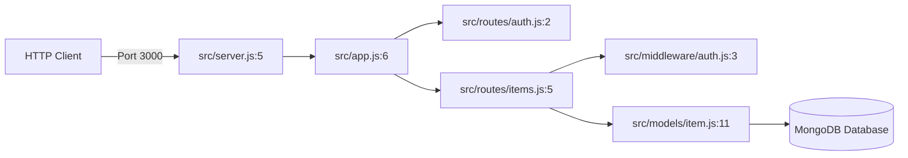

# 01 - System Architecture & Topology: demo-app

## Architectural Topology Diagram

## Core Architectural Boundaries & Modules
- **Application Server Bootstrap**: `src/server.js:1-7`
  - Responsibilities: Loads environment variables, binds HTTP listener to port.
- **Routing & Middleware Pipeline**: `src/app.js:6-14`
  - Responsibilities: Parses JSON payloads, attaches route prefixes `/auth` and `/items`.
- **Security & Authorization**: `src/middleware/auth.js:3-17`
  - Responsibilities: Decodes and verifies inbound JWT tokens using `process.env.JWT_SECRET`.
- **Data Persistence**: `src/models/item.js:3-11`
  - Responsibilities: Defines Mongoose schema, field validations, and MongoDB model mapping.

## Component Interaction & Data Pathways
Inbound HTTP requests hit the Express server configured in `src/app.js:6`. When accessing `/items` (e.g. `POST /items`), the request passes through the `requireAuth` middleware at `src/routes/items.js:12`, which verifies credentials in `src/middleware/auth.js:10` before handing execution to Mongoose model operations at `src/routes/items.js:13-15`.

## Cross-Cutting Concerns
- **Authentication & Authorization**: Handled via JWT middleware at `src/middleware/auth.js:3`.
- **Error Handling Strategy**: Standard Express HTTP 401 error response returned at `src/middleware/auth.js:6`.
- **Telemetry & Logging**: Console startup notice emitted at `src/server.js:6`.
