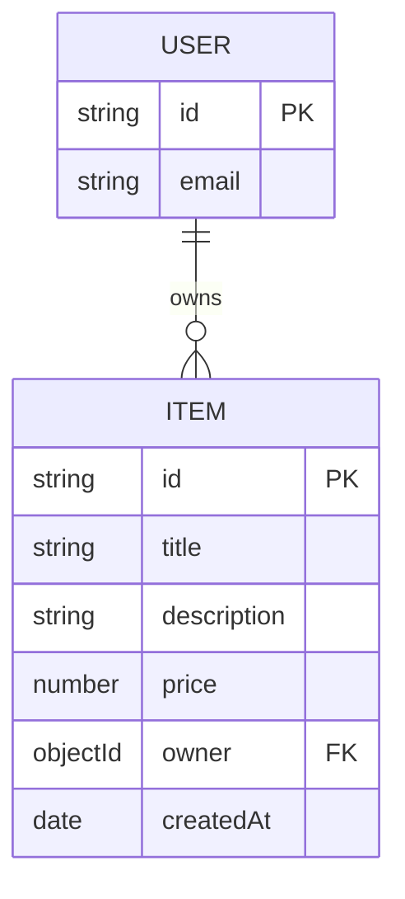

# 03 - API Surface & Data Model: demo-app

## Public HTTP / RPC Routes

| Method | Route Path | Handler Citation | Auth Required | Description |
| :--- | :--- | :--- | :--- | :--- |
| `POST` | `/auth/login` | `src/routes/auth.js:4` | No | Issues mock JWT authentication token |
| `POST` | `/auth/register` | `src/routes/auth.js:8` | No | Registers new user account |
| `GET` | `/items` | `src/routes/items.js:7` | No | Retrieves list of all items from database |
| `POST` | `/items` | `src/routes/items.js:12` | Yes (`requireAuth`) | Creates and saves a new item record |
| `DELETE` | `/items/:id` | `src/routes/items.js:18` | Yes (`requireAuth`) | Deletes an existing item by identifier |

## Database Entity-Relationship Diagram

## Entity Catalog & Schema Definitions

### Entity: `Item`
- **Source**: `src/models/item.js:3-11`
- **Fields**:
  - `title` (`String`): Required item title (`src/models/item.js:4`).
  - `description` (`String`): Optional item description (`src/models/item.js:5`).
  - `price` (`Number`): Mandatory numerical item price (`src/models/item.js:6`).
  - `owner` (`ObjectId`): Foreign reference to `User` model (`src/models/item.js:7`).
  - `createdAt` (`Date`): Timestamp defaulting to creation time (`src/models/item.js:8`).
- **Relationships**: Many items belong to one User (`src/models/item.js:7`).
