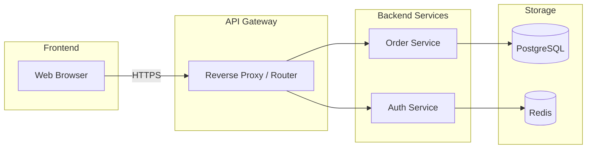
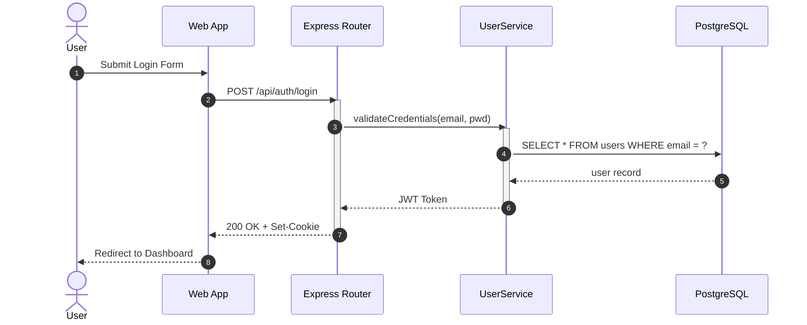
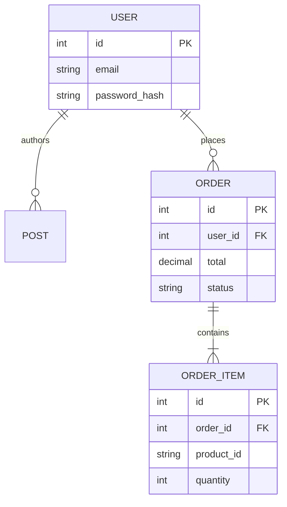
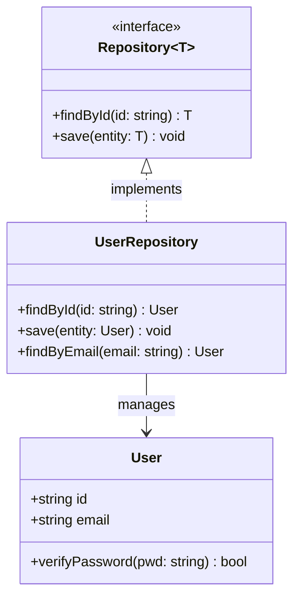
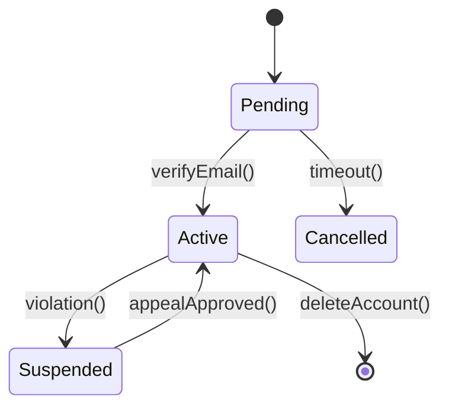

# Mermaid Cheatsheet for Reverse Engineering

Mermaid is the required diagramming format for all architectural, flow, data model, and dependency visualizations generated by this skill.

## 1. Flowchart (`graph LR` / `graph TD`)

Used for system component topology and module dependency maps.

## 2. Sequence Diagram (`sequenceDiagram`)

Used for tracing critical execution paths, request/response lifecycles, and event processing.

## 3. Entity-Relationship Diagram (`erDiagram`)

Used for database tables, schema models, and foreign key relations.

## 4. Class Diagram (`classDiagram`)

Used for object-oriented domain models, interfaces, and inheritance trees.

## 5. State Diagram (`stateDiagram-v2`)

Used for entity lifecycle state machines (e.g. order statuses, connection states).

## Common Mistakes to Avoid
1. **Unescaped Special Characters**: Do not put unescaped characters like `/`, `-`, `.` inside unquoted node names. Always wrap labels in quotes: `n1["src/models/user.ts"]`.
2. **Missing autowrap or large diagrams**: Keep diagrams under 40 nodes to prevent rendering timeouts and visual clutter.
3. **Invalid relationship cardinalities in erDiagram**: Use exact valid Mermaid cardinality tokens: `||--o{` (one to zero-or-more), `||--|{` (one to one-or-more), `||--||` (one to one).
